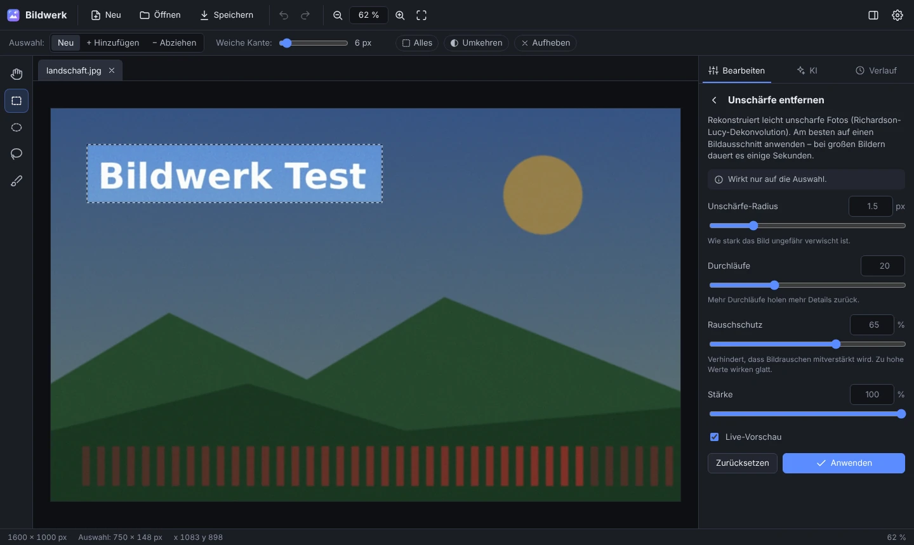

# Bildwerk

Ein kleines, erweiterbares Bildbearbeitungsprogramm, das lokal auf deinem Rechner läuft und im Browser bedient wird. Du kannst damit **Bildausschnitte auswählen und gezielt nachschärfen**, Fotos korrigieren und **Bilder per KI generieren oder bearbeiten lassen** – mit KI auf deiner eigenen Grafikkarte (kostenlos, offline) oder über einen Cloud-Anbieter.



## Funktionen

**Auswählen**
- Rechteck, Ellipse, Lasso (frei) und Pinsel (Bereich übermalen)
- Auswahlen kombinieren: hinzufügen (Umschalt) oder abziehen (Alt), umkehren, alles auswählen
- Weiche Kante, damit Bearbeitungen unsichtbar ins Bild übergehen

**Nachschärfen und verbessern** – wirkt auf die Auswahl oder das ganze Bild
- *Schärfen* (Unscharf maskieren) mit Stärke, Radius und Schwellwert
- *Unschärfe entfernen*: rekonstruiert leicht verwackelte oder unscharfe Bereiche (Richardson-Lucy-Dekonvolution mit Rauschschutz)
- *Klarheit* (lokaler Kontrast), *Rauschen reduzieren* (kantenerhaltend), *Weichzeichnen*, *Verpixeln* (z. B. für Gesichter oder Kennzeichen)
- *Detail-Zoom*: Ausschnitt vergrößern und nachschärfen, öffnet sich als neues Bild

**Korrigieren und Transformieren**
- Helligkeit & Kontrast, Tonwerte, Farbe (Sättigung, Farbtemperatur, Tönung), Auto-Kontrast, Schwarzweiß, Sepia, Invertieren
- Zuschneiden, Größe ändern, Drehen (90° und frei/Begradigen), Spiegeln
- Füllen und Löschen (transparent)

**KI** – lokal auf dem eigenen PC oder über Cloud-Anbieter
- *KI-Schärfen lokal*: Real-ESRGAN läuft direkt in Bildwerk auf der Grafikkarte, ohne Einrichtung
- *Lokal generieren und bearbeiten* über [ComfyUI](https://www.comfy.org) – mit Modellen wie SDXL, Z-Image oder FLUX.2
- *Bild generieren*: aus einer Textbeschreibung, mit Format, Qualität und Anzahl
- *Auswahl mit KI bearbeiten*: z. B. „Ersetze den Himmel durch einen Sternenhimmel“ oder „Entferne die Person“ – nur der ausgewählte Bereich ändert sich
- *KI-Schärfen & Vergrößern*: stellt unscharfe Bildausschnitte wieder her, im Bild oder als vergrößertes neues Bild
- Ergebnisse erscheinen erst als Vorschau mit *Vorher*, *Nochmal*, *Verwerfen* und *Übernehmen*

**Komfort**
- Live-Vorschau, Rückgängig/Wiederholen und ein Verlauf aller Schritte
- Mehrere Bilder in Tabs, Zoomen mit dem Mausrad, Verschieben mit gedrückter Leertaste
- Öffnen per Dialog, Drag & Drop oder Einfügen aus der Zwischenablage (Strg+V)
- Speichern als PNG, JPEG, WebP, AVIF oder TIFF – EXIF-Daten und Farbprofil bleiben erhalten, Handyfotos werden automatisch richtig gedreht

## Installation und Start

Du brauchst **Python** ([python.org/downloads](https://www.python.org/downloads/)), am besten **Python 3.13** (3.10 bis 3.14 funktionieren; für ganz neue Versionen fehlen manchen Paketen wie ONNX Runtime anfangs noch die fertigen Installationsdateien). Unter Windows bei der Installation „Add python.exe to PATH“ anhaken.

**Am einfachsten:**

- **Windows:** Doppelklick auf `start.bat`
- **macOS/Linux:** im Terminal `./start.sh`

Beim ersten Start wird automatisch eine eigene Python-Umgebung (`.venv`) eingerichtet, inklusive der lokalen KI. Danach öffnet sich Bildwerk im Browser (Standard: <http://127.0.0.1:8765>). Beenden mit **Strg+C** im Terminalfenster.

**Oder von Hand:**

```bash
python -m venv .venv
# Windows:      .venv\Scripts\activate
# macOS/Linux:  source .venv/bin/activate
pip install -e ".[local]"   # ohne lokale KI: pip install -e .
bildwerk                    # oder: python -m bildwerk
```

Nützliche Optionen: `bildwerk --port 9000`, `bildwerk --no-browser`. Mit `--host 0.0.0.0` ist Bildwerk auch von anderen Geräten im Heimnetz erreichbar (nur in vertrauenswürdigen Netzen verwenden).

**iPhone-Fotos (HEIC)** lassen sich nach `pip install -e ".[heic]"` öffnen.

> Die geöffneten Bilder liegen im Arbeitsspeicher des Bildwerk-Programms. Ein Neuladen der Seite ist kein Problem, beim Beenden von Bildwerk gehen ungespeicherte Änderungen aber verloren – also vorher speichern.

## KI einrichten

Bildwerk nutzt KI auf zwei Wegen, die sich beliebig kombinieren lassen:

| | Lokal auf deinem PC | Cloud-Anbieter |
|---|---|---|
| Kosten | keine | pro Bild beim Anbieter |
| Deine Bilder | bleiben auf dem Rechner | der bearbeitete Ausschnitt wird hochgeladen |
| Einrichtung | KI-Schärfen: keine · Generieren/Bearbeiten: ComfyUI installieren | API-Schlüssel eintragen |
| Voraussetzung | Grafikkarte empfohlen (z. B. NVIDIA RTX mit 8 GB) | Internetverbindung |

Im Reiter **KI** wählst du oben den Anbieter. Unter **⚙ Einstellungen** siehst du, ob alles bereit ist.

### Lokal: KI-Schärfen direkt in Bildwerk

Wähle im Reiter *KI* den Anbieter **„Lokal auf diesem PC“**. Das KI-Schärfen nutzt [Real-ESRGAN](https://github.com/xinntao/Real-ESRGAN) und rechnet unter Windows über DirectML auf der Grafikkarte (z. B. RTX 5060), sonst auf dem Prozessor. Beim ersten Schärfen lädt Bildwerk das Modell einmalig herunter (oder vorab unter ⚙ Einstellungen):

| Verfahren | Modell | Download |
|---|---|---|
| Fotos – schnell | Real-ESRGAN General (schärft und entrauscht) | 9,4 MB |
| Fotos – hohe Qualität | Real-ESRGAN x4plus (kräftigere Rekonstruktion, langsamer) | 64 MB |

Die Modelle liegen im Einstellungsordner unter `models` (Windows: `%APPDATA%\Bildwerk\models`). Falls die Grafikkarte Probleme macht, rechnet Bildwerk mit der Umgebungsvariable `BILDWERK_LOCAL_DEVICE=cpu` auf dem Prozessor.

### Lokal: Generieren und Bearbeiten mit ComfyUI

Für das Erzeugen und Bearbeiten von Bildern nutzt Bildwerk [ComfyUI](https://www.comfy.org) – das verbreitetste Programm für lokale Bild-KI. ComfyUI kümmert sich um Modelle und Grafikkarte, Bildwerk schickt ihm die Aufträge.

1. **ComfyUI installieren:** [ComfyUI Desktop](https://www.comfy.org/download) für Windows herunterladen und mit der Einstellung für NVIDIA-Grafikkarten installieren.
2. **Ein Modell besorgen** – Empfehlungen für 8 GB Grafikspeicher:
   - **SDXL-Modelle** (z. B. SDXL 1.0 oder darauf aufbauende Modelle wie Juggernaut XL oder RealVisXL, je ca. 7 GB): Die `.safetensors`-Datei in den ComfyUI-Ordner `models/checkpoints` legen – fertig. Bildwerk bringt die passenden Abläufe zum Generieren und Bearbeiten selbst mit. Zum Bearbeiten von Bereichen eignen sich Inpainting-Varianten besonders gut.
   - **Z-Image Turbo** (sehr gute Fotoqualität in wenigen Schritten) oder **FLUX.2 [klein]**: In ComfyUI unter *Workflow → Browse Templates* die passende Vorlage öffnen, die fehlenden Modelle herunterladen lassen und einmal in ComfyUI testen. Anschließend über *Workflow → Export (API)* als Datei speichern und in Bildwerk unter ⚙ Einstellungen → *Eigene Workflows* importieren.
3. **Loslegen:** ComfyUI starten, in Bildwerk den Anbieter **„ComfyUI (lokal)“** und in den Karten *Bild generieren* bzw. *Auswahl mit KI bearbeiten* das Modell wählen.

Bildwerk findet ComfyUI automatisch (Ports 8000, 8001 und 8188). Läuft ComfyUI woanders, z. B. auf einem anderen Rechner, trägst du die Adresse unter ⚙ Einstellungen ein.

**Eigene Workflows:** Bildwerk erkennt im exportierten Workflow selbst, wohin Beschreibung, Bildgröße, Seed und Anzahl gehören. Eindeutig wird es, wenn du vor dem Export `{{prompt}}` (und optional `{{negative}}`) in die Textfelder schreibst. Workflows mit einem *Load Image*-Knoten dienen zum Bearbeiten: Bildwerk lädt den Ausschnitt hoch, die Auswahl steckt dabei als durchsichtiger Bereich im Bild (in ComfyUI der *MASK*-Ausgang von *Load Image*). Eingesetzt wird das Ergebnis nur innerhalb deiner Auswahl.

**Tipps für 8 GB Grafikspeicher:** Größere Modelle lagert ComfyUI teilweise in den Arbeitsspeicher aus – mit viel RAM (z. B. 64 GB) funktioniert das, es dauert nur länger. Schneller geht es mit FP8- oder GGUF-Varianten der Modelle. Der erste Auftrag nach dem Start dauert länger, weil das Modell geladen wird. Meldet ComfyUI zu wenig Grafikspeicher, hilft ein kleineres Format oder ein kleineres Modell.

**Lizenzen:** Real-ESRGAN steht unter der BSD-Lizenz. Die Bildmodelle haben eigene Lizenzen; manche erlauben nur die nicht-kommerzielle Nutzung – für private Projekte passt das. Die Bedingungen stehen jeweils auf der Seite des Modells.

### Cloud-Anbieter

Für die Cloud brauchst du einen API-Schlüssel bei **mindestens einem** Anbieter. Die Nutzung wird vom Anbieter pro Bild abgerechnet.

| Anbieter | Kann | Schlüssel erstellen |
|---|---|---|
| OpenAI (GPT Image) | Generieren, Bereiche bearbeiten, KI-Schärfen | <https://platform.openai.com/api-keys> |
| Google Gemini („Nano Banana“) | Generieren, Bereiche bearbeiten, KI-Schärfen | <https://aistudio.google.com/apikey> |
| Stability AI | Generieren, Bereiche bearbeiten, KI-Hochskalieren (4×) | <https://platform.stability.ai/account/keys> |

Den Schlüssel trägst du in Bildwerk unter **⚙ Einstellungen** ein. Er wird nur lokal gespeichert (Windows: `%APPDATA%\Bildwerk`, macOS: `~/Library/Application Support/Bildwerk`, Linux: `~/.config/bildwerk`). Alternativ kannst du `.env.example` nach `.env` kopieren und die Schlüssel dort eintragen, oder die Umgebungsvariablen `OPENAI_API_KEY`, `GEMINI_API_KEY` bzw. `STABILITY_API_KEY` setzen.

Die Modellnamen ändern sich bei den Anbietern regelmäßig – die Liste steht jeweils oben in `bildwerk/ai/<anbieter>_provider.py` und lässt sich dort leicht anpassen. Manche OpenAI-Modelle setzen eine verifizierte Organisation im OpenAI-Konto voraus.

## So geht's

**Bildausschnitt nachschärfen**
1. Bild öffnen (oder in das Fenster ziehen).
2. Mit Rechteck (M), Lasso (L) oder Pinsel (B) den Bereich auswählen; bei Bedarf „Weiche Kante“ erhöhen.
3. Rechts unter *Bearbeiten* → *Schärfen* oder *Unschärfe entfernen* wählen. Die Live-Vorschau zeigt das Ergebnis sofort; zum Vergleich ins Bild zoomen (Mausrad, Taste 1 für 100 %).
4. *Anwenden* – und mit Strg+S speichern.

**Bild generieren:** Reiter *KI* → Beschreibung eingeben → *Generieren*. Das Ergebnis öffnet sich als neues Bild.

**Bereich per KI ändern:** Bereich auswählen → Reiter *KI* → unter *Auswahl mit KI bearbeiten* beschreiben, was passieren soll → *Auswahl bearbeiten* → Ergebnis prüfen und *Übernehmen*.

**KI-Schärfen:** Einen überschaubaren Bereich wählen (z. B. ein Gesicht oder ein Schild) → Reiter *KI* → Anbieter „Lokal auf diesem PC“ → *KI-Schärfen*. Mit „Als neues, vergrößertes Bild öffnen“ entsteht ein hochaufgelöster Detail-Zoom.

### Tastenkürzel

| Taste | Funktion | Taste | Funktion |
|---|---|---|---|
| Strg+O | Öffnen | Strg+S | Speichern |
| Strg+Z | Rückgängig | Strg+Y / Strg+Umschalt+Z | Wiederholen |
| Strg+A | Alles auswählen | Strg+D / Esc | Auswahl aufheben |
| Strg+Umschalt+I | Auswahl umkehren | Strg+C | Auswahl kopieren |
| V oder Leertaste | Verschieben (Hand) | M / E / L / B | Rechteck / Ellipse / Lasso / Pinsel |
| [ und ] | Pinsel kleiner / größer | + / − / 0 / 1 | Zoom: rein / raus / einpassen / 100 % |
| S | Schärfen | C | Zuschneiden |
| N | Neues Bild | Enter | Geöffnete Funktion anwenden |

Beim Auswählen: **Umschalt** gedrückt halten fügt hinzu, **Alt** zieht ab.

## Selbst erweitern

Bildwerk ist so gebaut, dass neue Funktionen wenig Code brauchen.

**Neue Bildoperation** – die Regler in der Oberfläche entstehen automatisch aus den Parametern. Zum Beispiel in `bildwerk/ops/filters.py`:

```python
from PIL import ImageOps

@operation(
    "posterize", "Tontrennung", "filter",
    params=[Param("bits", "Bits pro Kanal", "int", 3, min=1, max=8)],
    description="Reduziert die Anzahl der Farbstufen.",
)
def posterize(img, ctx, *, bits):
    return ImageOps.posterize(img, bits)
```

Nach einem Neustart erscheint „Tontrennung“ in der Liste – inklusive Live-Vorschau, Auswahl-Unterstützung und Rückgängig.

**Neuer KI-Anbieter** – eine Unterklasse von `Provider` (siehe `bildwerk/ai/base.py`) mit den Methoden `generate`, `edit` und/oder `upscale`, eingetragen in `PROVIDER_CLASSES` in `bildwerk/ai/__init__.py`. Ausschnitt, Maske und das nahtlose Einmischen des Ergebnisses übernimmt `bildwerk/ai/pipeline.py`.

## Projektaufbau

```
bildwerk/
  __main__.py        Start (Befehl „bildwerk“), öffnet den Browser
  server.py          HTTP-Schnittstelle (FastAPI)
  document.py        geöffnete Bilder, Verlauf, Vorschauen
  engine.py          führt Operationen aus – auf Wunsch nur in der Auswahl
  selection.py       Auswahlformen → Masken mit weicher Kante
  imageio.py         Laden, Farbprofile, EXIF, Export
  settings.py        Einstellungen und API-Schlüssel
  ops/               alle Bildoperationen (Anpassungen, Filter, Transformationen)
  ai/                KI-Anbieter (lokal, ComfyUI, OpenAI, Gemini, Stability) und Pipeline
  ai/local/          Real-ESRGAN: Gewichte lesen, ONNX-Modell bauen, auf der Grafikkarte rechnen
  static/            Oberfläche (HTML, CSS, JavaScript ohne Build-Schritt)
tests/               automatische Tests (pytest, Browser-Tests mit Playwright)
```

## Entwicklung und Tests

```bash
pip install -e ".[dev,local]"
pytest -m "not e2e"                  # schnelle Tests
python -m playwright install chromium
pytest -m e2e                        # Browser-Tests der Oberfläche
```

Die KI-Anbieter werden in den Tests mit simulierten Antworten geprüft – es entstehen dabei keine Kosten. Die lokalen Modelle prüfen die Tests mit kleinen Testgewichten gegen die Original-Architekturen aus PyTorch, ComfyUI mit einem simulierten Server. Bei jedem Push laufen die Tests per GitHub Actions unter Windows, macOS und Linux.

## Datenschutz und Sicherheit

- Bildwerk läuft nur auf deinem Rechner und ist standardmäßig nur dort erreichbar (`127.0.0.1`).
- Bilder verlassen den Rechner nur, wenn du einen Cloud-Anbieter nutzt – dann wird der betroffene Ausschnitt an ihn gesendet. Die lokale KI und ComfyUI auf deinem PC arbeiten ohne Internet; nur die Modelle werden einmalig heruntergeladen.
- API-Schlüssel werden nie an die Oberfläche zurückgegeben (nur die letzten vier Zeichen zur Kontrolle). Anfragen von fremden Webseiten an Bildwerk werden blockiert.
